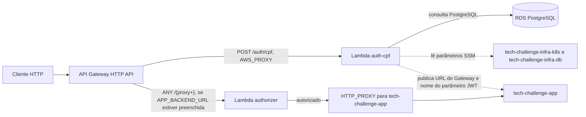
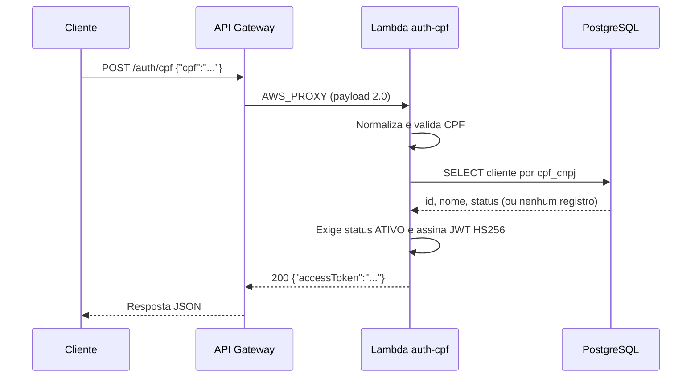
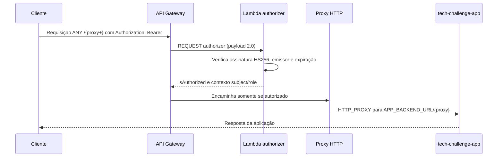

# Tech Challenge: autenticação por CPF

Repositório da solução do Tech Challenge Fase 3 (Grupo 15, Pós FIAP/SOAT). Provisiona duas funções AWS Lambda em Node.js e uma HTTP API no API Gateway: uma emite JWT após autenticar um CPF e a outra autoriza o proxy para a API da aplicação.

## Propósito

A rota pública `POST /auth/cpf` recebe um CPF, valida seus dígitos verificadores, consulta o cliente no PostgreSQL e emite um JWT apenas se o cliente existir e estiver com status `ATIVO`. Quando `APP_BACKEND_URL` está configurada, o API Gateway também encaminha as demais rotas para `tech-challenge-app`, após validar o Bearer token com uma Lambda authorizer.

## Tecnologias

| Tecnologia | Uso confirmado |
|---|---|
| Node.js | O pacote exige `>=20`; as funções Lambda usam runtime `nodejs20.x` e o CI configura Node.js 20. |
| `jsonwebtoken` `^9.0.2` | Emissão e verificação de JWT. |
| `pg` `^8.13.1` | Conexão PostgreSQL com o banco de clientes. |
| Node.js Test Runner | Testes executados com `node --test`. |
| AWS Lambda e API Gateway HTTP API | Execução das funções, rota pública, authorizer e proxy HTTP. |
| Terraform | Provisionamento; versão requerida `>= 1.5`, provider AWS `~> 6.0`. O workflow instala Terraform `1.9.8`. |

### Código-fonte

| Arquivo | Responsabilidade |
|---|---|
| [`src/authCpf.js`](src/authCpf.js) | Handler da rota pública: interpreta `event.body`, valida o CPF, consulta o cliente, trata os status HTTP e emite o token. |
| [`src/authorizer.js`](src/authorizer.js) | Lambda authorizer REQUEST, formato 2.0: extrai `Authorization: Bearer`, verifica o JWT e retorna `isAuthorized` e contexto `subject`/`role`. |
| [`src/cpf.js`](src/cpf.js) | Normaliza o CPF para 11 dígitos e valida os dígitos verificadores, rejeitando sequências repetidas. |
| [`src/db.js`](src/db.js) | Abre conexão PostgreSQL e consulta `id`, `nome` e `status` em `clientes` pelo campo `cpf_cnpj`. |
| [`src/jwt.js`](src/jwt.js) | Emite e verifica tokens com algoritmo HS256 e o emissor definido no código. |
| [`test/cpf.test.js`](test/cpf.test.js) | Testes de normalização e validação de CPF. |

O JWT usa HS256, `iss` (`tech-challenge-backend`), `iat`, `exp`, `sub` (CPF), `role` (`CLIENTE`) e `clienteId`. A expiração é de 3.600 segundos. O authorizer aceita somente tokens verificáveis com HS256 e o emissor esperado. A chave é compartilhada com a aplicação; nenhum valor secreto é documentado aqui.

### Variáveis de ambiente

Nomes definidos pelo código/Terraform, sem valores:

- `JWT_SECRET` (ambas as funções; chave compartilhada para JWT)
- `DB_HOST`, `DB_PORT`, `DB_NAME`, `DB_USER`, `DB_PASSWORD` (função de autenticação)

O pipeline também referencia os secrets `AWS_ACCESS_KEY_ID`, `AWS_SECRET_ACCESS_KEY`, `AWS_SESSION_TOKEN`, `TF_VAR_JWT_SECRET` (produção) e `TF_VAR_JWT_SECRET_HOMOLOG` (homologação), além das variáveis `APP_BACKEND_URL` e `APP_BACKEND_URL_HOMOLOG`, respectivamente.

## Diagrama da arquitetura



O Terraform obtém da VPC as subnets por SSM. A Lambda de autenticação roda nessas subnets e seu Security Group permite saída TCP na porta `5432` para o CIDR da VPC. A função authorizer não tem `vpc_config` definido e não consulta o banco. O proxy da aplicação não é criado enquanto `app_backend_url` estiver vazia.

### Fluxo de login por CPF



### Fluxo de chamada protegida



## Passos de execução e deploy

### Testes locais

Requer Node.js compatível com `>=20` e npm.

```bash
npm ci
npm test
```

O endpoint recebe JSON no campo `cpf` e retorna JSON. Exemplo de chamada (substitua a URL pelo endpoint publicado):

```bash
curl -X POST "<URL_DO_API_GATEWAY>/auth/cpf" \
  -H "Content-Type: application/json" \
  -d '{"cpf":"52998224725"}'
```

Resposta de sucesso implementada:

```json
{"accessToken":"<JWT retornado>"}
```

O handler também retorna `400` para JSON inválido ou CPF inválido, `404` quando não encontra cliente, `403` para cliente inativo e `500` em erro ao consultar o banco.

### Deploy com Terraform

1. Aplique previamente `tech-challenge-infra-k8s` e `tech-challenge-infra-db`: este projeto precisa do bucket S3 configurado como backend, dos parâmetros de rede e dos parâmetros do banco.
2. Configure `jwt_secret` em `terraform.tfvars` ou por `TF_VAR_jwt_secret`; configure `app_backend_url`/`APP_BACKEND_URL` quando o proxy da aplicação puder ser ativado. O segredo JWT deve corresponder ao configurado pela aplicação.
3. Gere o pacote `build/lambda.zip` com as dependências de produção. O workflow gera o pacote antes do Terraform; o caminho padrão do Terraform é `../build/lambda.zip` a partir de `infra/`.
4. Execute os comandos abaixo no diretório `infra/`, com acesso AWS e parâmetros SSM disponíveis. O pipeline automatiza esse processo para `main` (produção) e `homolog` (homologação), além de oferecer ações manuais.

```bash
terraform init -backend-config=environments/production.s3.tfbackend
terraform plan -var-file=environments/production.tfvars
terraform apply -var-file=environments/production.tfvars
```

Para homologação, troque `production` por `homolog` nos caminhos dos comandos. Essa stack usa nomes com sufixo `-homolog`, parâmetros SSM em `/tech-challenge-homolog/*` e outra key de state no mesmo bucket. Ao alternar entre ambientes na mesma pasta, execute `terraform init -reconfigure -backend-config=environments/homolog.s3.tfbackend` (ou o arquivo de produção, conforme o destino).

O Terraform publica os outputs `api_gateway_url` e `auth_cpf_endpoint`.

## Pipeline CI/CD

O workflow [`pipeline.yml`](.github/workflows/pipeline.yml) tem estes gatilhos:

- `push` para `main` ou `homolog`;
- `pull_request` com destino a `main` ou `homolog`;
- `workflow_dispatch`, com ação `plan`, `apply` ou `destroy`.

Após checkout, o job de testes configura Node.js 20, executa `npm ci` e `npm test`. O job de plan depende dos testes: instala dependências de produção, empacota `src`, `node_modules` e `package.json`, verifica o secret JWT do ambiente, configura credenciais AWS, instala Terraform `1.9.8`, executa `terraform init`, `terraform validate` e `terraform plan`. O init usa `environments/$DEPLOY_ENV.s3.tfbackend` e o plan usa `environments/$DEPLOY_ENV.tfvars`. O ambiente é escolhido pela branch de destino do PR ou pela branch do push/dispatch: `homolog` seleciona homologação; as demais selecionam produção. Em dispatch, esse job roda quando a ação escolhida é `plan`.

O job de deploy também depende dos testes e usa o environment `production` para `main` ou `homolog` para a branch homônima. Em push para essas branches, faz `terraform apply`; no dispatch, executa `apply` ou `destroy` conforme a ação escolhida, usando os arquivos de backend e variáveis do ambiente selecionado.

Secrets e variáveis referenciados pelo workflow: `AWS_ACCESS_KEY_ID`, `AWS_SECRET_ACCESS_KEY`, `AWS_SESSION_TOKEN`, `TF_VAR_JWT_SECRET`, `APP_BACKEND_URL`, `TF_VAR_JWT_SECRET_HOMOLOG` e `APP_BACKEND_URL_HOMOLOG`. O segredo JWT e a URL de backend são selecionados conforme o ambiente.

## Fluxo de branches

O workflow reage a PRs destinados a `main` ou `homolog` e executa testes e plan para o ambiente da branch de destino. Push nessas branches executa os testes, plan e o job de apply.
Deploy para produção: job Terraform Apply associado ao environment `production`, com apply em push para `main` ou dispatch `apply` nessa branch. Deploy para homologação: o mesmo job associado ao environment `homolog`, com apply em push para `homolog` ou dispatch `apply` nessa branch.

## Links

- Swagger local: <http://localhost:8080/swagger-ui.html>
- Coleções [Postman](postman/): [acompanhamento](postman/acompanhamento.collection.json), [atendimento](postman/atendimento.collection.json), [estoque](postman/estoque.collection.json) e [coleção completa](postman/Tech-Challenge-Completa-Production.collection.json).
- [Documentação arquitetural](docs/README.md): [diagrama de componentes](docs/component-diagram.md), [sequência de autenticação e OS](docs/sequence-auth-os.md), [diagrama ER](docs/er-diagram.md), [ADRs](docs/adrs/) e [RFCs](docs/rfcs/).
- [tech-challenge-infra-k8s](https://github.com/postech-grupo-16/tech-challenge-infra-k8s)
- [tech-challenge-infra-db](https://github.com/postech-grupo-16/tech-challenge-infra-db)
- [tech-challenge-app](https://github.com/postech-grupo-16/tech-challenge-app)

## Ordem de execução entre repositórios e SSM

`tech-challenge-infra-k8s` e `tech-challenge-infra-db` precisam estar aplicados antes deste repositório. Depois de aplicar este projeto, `tech-challenge-app` pode consumir a URL pública e o parâmetro JWT publicados aqui. Para ativar o proxy, `APP_BACKEND_URL` precisa estar configurada e o Terraform deve ser aplicado novamente.

Os nomes de parâmetros abaixo correspondem à produção. Em homologação, o prefixo é `/tech-challenge-homolog/` tanto para os parâmetros consumidos quanto para os publicados; aplique previamente as stacks de infraestrutura correspondentes a esse ambiente.

Parâmetros SSM **consumidos** por este Terraform:

| Parâmetro | Origem/uso confirmado |
|---|---|
| `/tech-challenge/vpc_id` | VPC usada pela Lambda. |
| `/tech-challenge/vpc_cidr` | CIDR da VPC; destino permitido no egress do Security Group da Lambda. |
| `/tech-challenge/subnet_ids` | Subnets da VPC atribuídas à Lambda de autenticação. |
| `/tech-challenge/rds_endpoint` | Host do banco. |
| `/tech-challenge/rds_port` | Porta do banco. |
| `/tech-challenge/rds_db_name` | Nome do banco. |
| `/tech-challenge/rds_user` | Usuário do banco; leitura com decriptação. |
| `/tech-challenge/rds_password` | Senha do banco; leitura com decriptação. |

Parâmetros SSM **publicados** por este Terraform:

| Parâmetro | Tipo/uso confirmado |
|---|---|
| `/tech-challenge/api_gateway_url` | `String`; URL pública do API Gateway, consumida pelo pipeline da aplicação. |
| `/tech-challenge/jwt_secret` | `SecureString`; segredo JWT compartilhado, consumido pela aplicação. Este README registra somente o nome. |